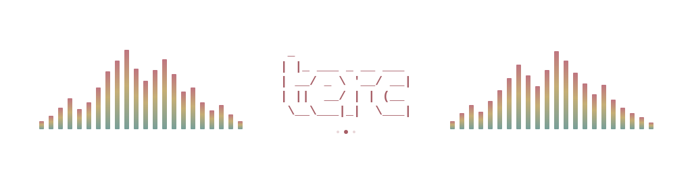
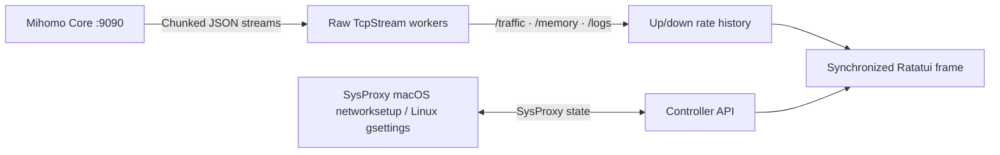

<h1 align="center">terc</h1>

<p align="center">
  <a href="README.md">简体中文</a> &nbsp; / &nbsp; <strong>English</strong>
</p>

<p align="center">
  <strong>The ultimate TUI proxy tool for developers in China</strong>
</p>

<p align="center">
  <code>terc</code> draws on GUI and non-GUI Clash clients, with extra features for developers and AI tools. Built to work well remotely, use less memory, feel comfortable to use, and save you hassle.
</p>

<p align="center">
  
  &nbsp;
  
  &nbsp;
  
  &nbsp;
  
  &nbsp;
  
</p>

<p align="center">
  <a href="#quick-start"><strong>Get started</strong></a> &nbsp; · &nbsp;
  <a href="docs/usage.en.md">User guide</a> &nbsp; · &nbsp;
  <a href="#what-it-shows">Features</a> &nbsp; · &nbsp;
  <a href="#controls">Key bindings</a>
</p>

<br>

<p align="center">
  
</p>

<p align="center">
  <a href="https://ghostty.org"></a><br>
  <sub>Works best with <a href="https://ghostty.org"><strong>Ghostty</strong></a></sub>
</p>

---

## Quick Start

**Requires:** macOS 14+ or Linux (x86_64 / arm64), Rust stable, and a `mihomo` binary (`brew install mihomo` on macOS, or the matching official build from inside `terc`). See the [guide](docs/usage.en.md) and the [Chinese manual](docs/使用说明.md).

```bash
git clone https://github.com/wormforce/terc.git
cd terc
cargo run --release --locked
```

`terc` opens on the dashboard. Press **Space** to toggle the system proxy (macOS `networksetup`, or Linux GNOME `gsettings` when `org.gnome.system.proxy` is present; otherwise it stays unchanged and says so), or press **K** to start/stop the background `mihomo` daemon. Run `terc --version` to verify the installed version.

Setup appears only when there is no subscription URL, no `config.yaml`, and the core is not running: locate or download `mihomo` first, then paste a subscription URL (<kbd>Ctrl+D</kbd> downloads `darwin-arm64`, `darwin-amd64`, `linux-arm64`, or `linux-amd64` for this machine) and start the core. An existing config skips that and lands on the dashboard. <kbd>Esc</kbd> dismisses Setup and <kbd>u</kbd> brings it back while no subscription is configured — the system proxy is never switched on for you.

> [!NOTE]
> `terc` decouples the UI lifecycle from the proxy core. Closing `terc` with <kbd>q</kbd> immediately frees all terminal UI resources while your background `mihomo` tunnel continues running uninterrupted.

Transparency follows your terminal profile. `terc` leaves the background at its terminal default (`Color::Reset`); configure opacity or blur in your terminal emulator.

## What It Shows

| View | What you get |
| --- | --- |
| **Groups & Nodes** | Dual-pane selector with protocol tags (`AnyTLS`, `SS`, etc.) and color-graded latency (`ms`) |
| **Controls** | System proxy, routing mode, and TUN |
| **Traffic graph** | btop-style dual up/down rate history on an auto-scaled, labeled axis (`max …/s`), drawn as Braille or Blocks |
| **Overview** | Aligned core, mode, proxy, TUN, memory, and connection metrics; port and quota below |
| **Profiles** | Switch another YAML onto the running config and hot-reload |
| **Themes** | Spring, Vintage, and Mono; all preserve the terminal background |

<details>
<summary>Advanced tools and diagnostics</summary>

| View | What you get |
| --- | --- |
| **Connections** | Process, inbound, sniff host, rule payload, chain, and geo/ASN, with one-key close |
| **DNS** | Resolver status from the config, live lookup, and DNS / Fake-IP flush |
| **Rules** | Ordered list with live hit counts, local explain, and runtime disable |
| **Providers (`v`)** | `proxy-providers` and `rule-providers`, not the airport subscription URL. Refresh one or all; proxy providers can run a health check |
| **Snippets** | YAML overlays for TUN, sniffer, Fake-IP, process lookup, TCP racing, and IPv6 |
| **Probe** | DNS answers plus a delay test of the selected node |
| **Runtime** | TUN device and any WireGuard or Tailscale outbound the core already exposes |
| **Logs** | Live core logs with severity highlighting, pause, search, and full-text reading |

</details>

The footer has one line of shortcuts. Operation results appear in the content area: Backspace dismisses them; `!` opens the full result. Help scrolls with arrow keys or Page Up/Down. In Connections, Enter opens full details even in a narrow terminal. In Logs, use `P` to pause/resume, `/` to search, and Enter to read the full message.

## Controls

| Where | Key | Action |
| --- | --- | --- |
| Dashboard / Settings | <kbd>Space</kbd> | Toggle the system proxy. macOS uses `networksetup`; Linux uses GNOME `gsettings` and otherwise leaves it unchanged. Never toggled for you |
| Dashboard | <kbd>K</kbd> | Start or stop the background `mihomo` process managed by terc |
| Proxies | <kbd>←</kbd> <kbd>→</kbd>, <kbd>h</kbd> <kbd>l</kbd>, or <kbd>Tab</kbd> | Switch focus between **Groups `[1]`** and **Nodes `[2]`** |
| Any list | <kbd>↑</kbd> <kbd>↓</kbd> or <kbd>j</kbd> <kbd>k</kbd> | Move the selection |
| Nodes | <kbd>Enter</kbd> | Activate the highlighted node in the current group |
| Proxies | <kbd>r</kbd> | Run concurrent URL latency tests for the current group |
| Proxies | <kbd>a</kbd> | Auto-select the lowest-latency node in the current group |
| Dashboard | <kbd>m</kbd> | Cycle routing mode (`Rule` → `Global` → `Direct`) |
| Dashboard | <kbd>u</kbd> | Fetch latest subscription YAML and hot-reload core (`PUT /configs?force=true`); opens the setup window when no URL is saved |
| Setup window | <kbd>Enter</kbd> | Save the subscription URL, write the config and start the core |
| Setup window | <kbd>Ctrl+U</kbd> / <kbd>Ctrl+D</kbd> | Clear the input line / download a managed `mihomo` core |
| Setup window | <kbd>Esc</kbd> | Dismiss for now — <kbd>u</kbd> reopens it while nothing is configured |
| Dashboard | <kbd>p</kbd> / <kbd>c</kbd> / <kbd>L</kbd> | Switch main pane: **Proxies** / **Connections** / **Logs** |
| Dashboard | <kbd>t</kbd> | Show or hide the top Traffic & Overview panels |
| Dashboard | <kbd>s</kbd> | Open the dual-pane Settings board. Press again there to return |
| Settings | <kbd>←</kbd> <kbd>→</kbd>, <kbd>h</kbd> <kbd>l</kbd>, or <kbd>Enter</kbd> | Adjust setting or trigger action |
| Settings | <kbd>Tab</kbd> / <kbd>Shift+Tab</kbd> / <kbd>1</kbd>–<kbd>3</kbd> | Switch category pages (`Core & Proxy` · `Appearance` · `Subscription`) |
| Any view | <kbd>?</kbd> | Open keyboard shortcut help. Press again to return to the dashboard |
| Dashboard | <kbd>q</kbd> | Quit (`mihomo` stays running in the background) |
| Dashboard | <kbd>Esc</kbd> | Return to the proxy list; press q to quit |
| Settings / Help | <kbd>Esc</kbd> | Return to the dashboard |

<details>
<summary>Advanced shortcuts</summary>

| Where | Key | Action |
| --- | --- | --- |
| Dashboard | <kbd>T</kbd> / <kbd>n</kbd> / <kbd>i</kbd> | Toggle TUN, sniffer, or IPv6. Runtime `PATCH`, then the same value is written back |
| Dashboard | <kbd>D</kbd> | Toggle `dns.enable` in the config and hot-reload |
| Dashboard | <kbd>d</kbd> / <kbd>g</kbd> / <kbd>v</kbd> | DNS, rules, providers |
| Dashboard | <kbd>o</kbd> / <kbd>f</kbd> / <kbd>b</kbd> / <kbd>w</kbd> | Snippet gallery, profiles, probe, WireGuard / runtime |
| Rules | <kbd>/</kbd> or <kbd>e</kbd> | Filter the list and explain a host, IP, or `process:name` |
| Rules | <kbd>x</kbd> | Disable or restore the selected rule (`PATCH /rules/disable`) |
| DNS | <kbd>Enter</kbd> / <kbd>F</kbd> / <kbd>[</kbd> <kbd>]</kbd> | Look up, flush DNS and Fake-IP, cycle record type |
| Providers | <kbd>Enter</kbd> / <kbd>F</kbd> / <kbd>H</kbd> | Refresh the selected provider, refresh all, or health-check a proxy provider |
| Connections | <kbd>x</kbd> / <kbd>X</kbd> | Close selected connection / close all active connections |

</details>

Install the core before submitting the first subscription (`Ctrl+D` in Setup downloads it). Subscription, snippet and profile changes are validated with `mihomo -t` before replacing the configuration; rejected reloads restore the previous file. Enabled snippets are reapplied on subscription updates and profile switches. `K` stops only a core started by terc; use the service manager for external cores.

Logs: `P` pauses/resumes display while capture continues, `/` searches, and Enter opens full text. Connections: Enter opens full details on narrow terminals. Results remain accessible with graphs hidden; `!` opens the full result and Backspace dismisses it. Help supports arrows and Page Up/Down.

## Configuration

Open **Settings** with <kbd>s</kbd>. Changes save immediately to `~/.config/terc/config.json`. The interface supports **中文 · English · 日本語**.

| Category | Options |
| --- | --- |
| **Core & Proxy** | Start/stop `mihomo`, toggle the system proxy, switch routing mode, download `mihomo-darwin-arm64`, `darwin-amd64`, `linux-arm64`, or `linux-amd64` into `~/.config/terc/core/mihomo` |
| **Snippets** | Built-in YAML overlays, plus any file in `~/.config/terc/modules`. Enabling recursively merges mappings; disabling restores the source. Mihomo validates candidates before applying |
| **Profiles** | YAML files in the config directory and `~/.config/terc/profiles`. Enter copies one onto `config.yaml` and reloads |
| **Appearance** | Palette theme (`Spring` / `Vintage` / `Mono`), rate graph style (`Braille` / `Blocks`), UI refresh rate (`15` / `30` / `60` / `120 Hz`), graph interval (`1000–86400000 ms`, arrows adjust by `100 ms`, Enter accepts a typed value; averaged rates, clears history on change), UI language |
| **Subscription** | Hot-fetch remote AnyTLS / Clash.Meta YAML subscription and reload without dropping active tunnels |

The graph interval is set in milliseconds. Mihomo normally supplies one traffic sample per second, so the minimum is 1000 ms.

## How It Works

Instead of pulling in a heavy async HTTP stack, `terc` speaks raw HTTP/1.1 over `std::net::TcpStream` to the local controller (`127.0.0.1:9090`). Background threads read `/traffic`, `/memory`, and `/logs`. Toggles use `PATCH /configs` (`tun.enable`, `sniffing`, `ipv6`). DNS lookup is `GET /dns/query`, flush is `POST /cache/dns/flush` and `POST /cache/fakeip/flush`, and provider refresh is `PUT /providers/...`. Remote subscription and core downloads go through the system `curl`.



<details>
<summary>Project layout</summary>

```text
assets/terc-hero.svg           Retro terminal: rounded panels, title cutouts, braille graph
src/main.rs                    Event loop, screens, i18n
src/ui.rs                      Rounded cutout Panel, palettes, Braille/Blocks graph
src/panels.rs                  Controls, DNS, rules, providers, overlays
src/control.rs                 Toggle, reload, profile, and probe actions
src/ops.rs                     YAML overlays, rule explain, DNS/rule parsers
src/mihomo.rs                  HTTP/1.1 over TcpStream, streams, networksetup and gsettings
```

</details>

## Development

```bash
cargo test --all-targets --locked
cargo build --release --locked
```
