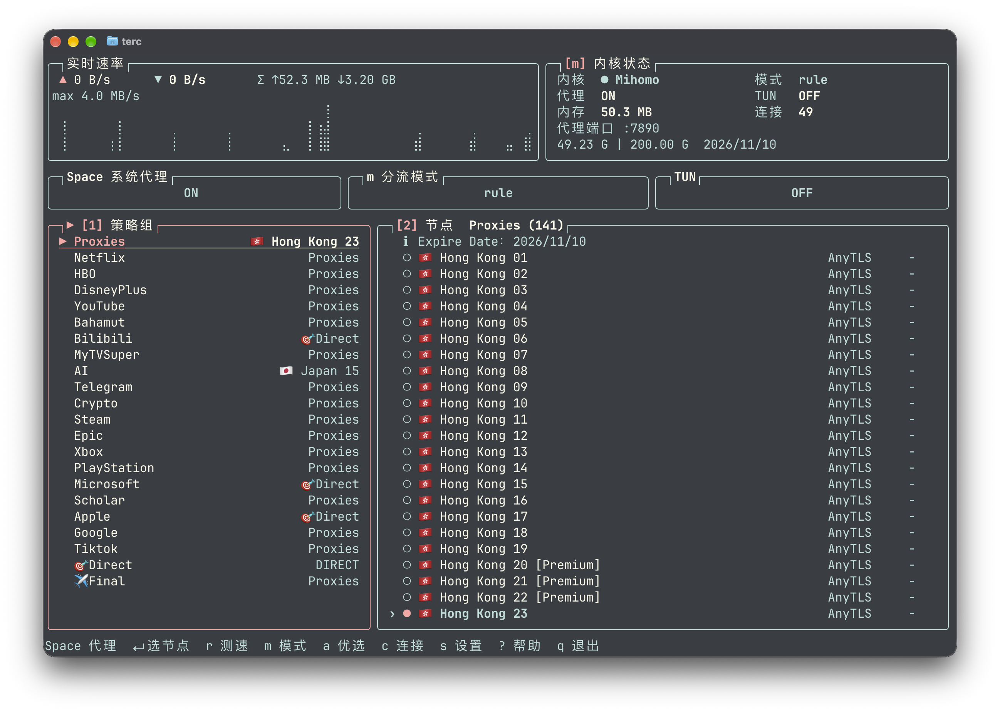
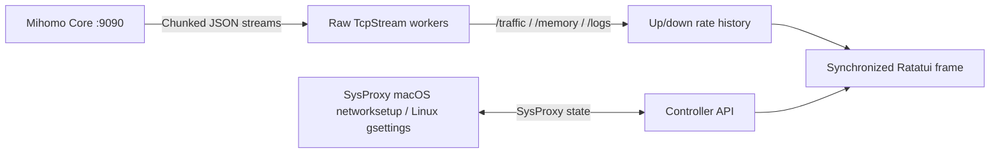

<h1 align="center">terc</h1>

<p align="center">
  <a href="README.md">简体中文</a> &nbsp; / &nbsp; <strong>English</strong>
</p>

<p align="center">
  <strong>The ultimate TUI proxy tool for developers in China</strong>
</p>

<p align="center">
  <code>terc</code> draws on GUI and non-GUI Clash clients, with extra features for developers and AI tools. Built to work well remotely, use less memory, feel comfortable to use, and save you hassle.
</p>

<p align="center">
  
  &nbsp;
  
  &nbsp;
  
  &nbsp;
  
  &nbsp;
  
</p>

<p align="center">
  <a href="#quick-start"><strong>Get started</strong></a> &nbsp; / &nbsp;
  <a href="docs/usage.en.md">User guide</a> &nbsp; / &nbsp;
  <a href="#what-it-shows">Features</a> &nbsp; / &nbsp;
  <a href="#controls">Key bindings</a>
</p>

<br>

<p align="center">
  
</p>

<p align="center">
  <a href="https://ghostty.org"></a><br>
  <sub>Works best with <a href="https://ghostty.org"><strong>Ghostty</strong></a></sub>
</p>

---

> [!IMPORTANT]
> **Usage notice:** This software is intended for use outside mainland China only, and solely for learning and research.

## Quick Start

**Requires:** macOS 14+ or Linux (x86_64 / arm64), Rust stable, and a `mihomo` binary, v1.19.27 or newer recommended (`empty-fallback` on region groups takes effect from that release; terc warns about an older core once it runs). Use `brew install mihomo` on macOS (`brew upgrade mihomo` for an existing one), or the matching official build from inside `terc`. See the [guide](docs/usage.en.md) and the [Chinese manual](docs/使用说明.md).

```bash
git clone https://github.com/wormforce/terc.git
cd terc
cargo run --release --locked
```

`terc` opens on the dashboard. Press **Space** there to toggle the system proxy (macOS `networksetup`, or Linux GNOME `gsettings` when `org.gnome.system.proxy` is present; otherwise it stays unchanged and says so). Start or stop the background `mihomo` managed by terc from Settings → Core & Proxy → Core service. Stopping the core turns off only a system proxy that still points at terc's port on 127.0.0.1; any other proxy, such as a corporate one, is left alone.

On macOS, turning on Settings → Core & Proxy → TUN opens the system administrator authorization dialog when enabling TUN requires elevated privileges. After approval, terc restarts its managed Mihomo as administrator; existing connections briefly disconnect, while the TUI stays an ordinary user process. Cancelling preserves the original core and restores the configuration. Stopping the elevated core from Core service may also require authorization; starting a core with TUN already enabled requests authorization immediately. TUN failures show the core error rather than reporting success from the API response alone. A manually launched local Mihomo using the same config directory can be adopted and restarted after authorization; terc checks its listening port, executable, and configuration arguments first. Stop Homebrew/launchd-managed cores through their service manager before starting one from Core service. On Linux, run Mihomo through a system service or grant the required network privileges.

Disconnect other full-tunnel VPNs, such as Shadowrocket, before enabling TUN to avoid conflicting routes. terc reports conflicting tunnel routes without deleting them. When a VPN becomes the primary interface, system proxy settings still use the active underlying hardware service, such as Wi-Fi.

Run `terc --version` to verify the installed version.

Setup appears only when there is no subscription URL, no `config.yaml`, and the core is not running: locate or download `mihomo` first, then paste a subscription URL (<kbd>Ctrl+D</kbd> downloads `darwin-arm64`, `darwin-amd64-v1`, `linux-arm64`, or `linux-amd64-v1` for this machine) and start the core. An existing config skips that and lands on the dashboard. <kbd>Esc</kbd> dismisses Setup for this run; add a subscription or node later with `a` in Settings → Sources & Routing, and download the core from Settings → Diagnostics → Download / update core. The system proxy is never switched on for you.

> [!NOTE]
> `terc` decouples the UI lifecycle from the proxy core. Closing `terc` with <kbd>q</kbd> immediately frees all terminal UI resources while your background `mihomo` tunnel continues running uninterrupted.

Transparency follows your terminal profile. `terc` leaves the background at its terminal default (`Color::Reset`); configure opacity or blur in your terminal emulator.

## What It Shows

| View | What you get |
| --- | --- |
| **Groups & Nodes** | Dual-pane selector with protocol tags (`AnyTLS`, `SS`, etc.) and color-graded latency (`ms`) |
| **Controls** | System proxy, routing mode, and TUN |
| **Traffic graph** | btop-style dual up/down rate history on an auto-scaled, labeled axis (`max …/s`), drawn as Braille or Blocks |
| **Overview** | Aligned core, mode, proxy, TUN, memory, and connection metrics; port and quota below |
| **Proxy subscriptions** | Add, update and switch subscriptions and manual nodes inside Settings; generated configs fill in missing TCP racing, url-test tolerance, Reality fingerprints and Linux TUN GSO, and flag foreign direct DNS and nodes without UDP |
| **Routing plans** | Independent rules and groups; each source remembers its assignment, and saved plans can be reused |
| **Themes** | Spring, Vintage, and Mono; all preserve the terminal background |


Press `s` → Sources & Routing for the named proxy list; Tab opens routing plans. Press `a` for the unified subscription/proxy form, `e` to edit the selected entry. Both pages stay inside Settings. Sources own nodes, while routing plans own rules and groups. Switching sources restores its assigned plan. Choose subscription routing, Proxy all, routing from another source, or use `c` to save current routing for reuse. Saved groups use current-source nodes, preserving group references and filters.

<details>
<summary>Advanced tools and diagnostics</summary>

| View | What you get |
| --- | --- |
| **Connections** | Process, inbound, sniff host, rule payload, chain, and geo/ASN; age, per-connection rate, AI tags, and recently closed long-lived/AI connections with an inferred cause; one-key close, with a prompt before actions that cut sessions |
| **DNS** | Resolver status from the config, live lookup, and DNS / Fake-IP flush |
| **Rules** | Ordered list with live hit counts, local explain, and runtime disable |
| **Providers (Settings → Diagnostics)** | `proxy-providers` and `rule-providers`, not the airport subscription URL. Refresh one or all; proxy providers can run a health check |
| **Snippets** | YAML overlays for TUN, sniffer, Fake-IP, process lookup, TCP racing, and IPv6 |
| **Probe** | DNS answers plus a delay test of the selected node |
| **Runtime** | TUN device and any WireGuard or Tailscale outbound the core already exposes |
| **Logs** | Live core logs with severity highlighting, pause, search, and full-text reading |

</details>

The footer has one line of shortcuts. Floating notifications disappear after 4 seconds (8 seconds for errors). Backspace dismisses them early; `!` still opens the full result afterward. Help scrolls with arrow keys or Page Up/Down. In Connections, Enter opens full details even in a narrow terminal. In Logs, use `P` to pause/resume, `/` to search, and Enter to read the full message.

Click a group to browse its nodes; click a node to activate it. Scrolling moves the selection without activating nodes. A bright bold border, ▶ marker, and underlined selected row identify the focused pane.

## Controls

| Where | Key | Action |
| --- | --- | --- |
| Dashboard | <kbd>Space</kbd> | Toggle the system proxy. macOS uses `networksetup`; Linux uses GNOME `gsettings` and otherwise leaves it unchanged. Never toggled for you. In Settings → Core & Proxy → System proxy, use <kbd>←</kbd> <kbd>→</kbd> or <kbd>Enter</kbd> |
| Settings → Core & Proxy | Core service | Start or stop the background `mihomo` process managed by terc |
| Settings → Core & Proxy | TUN | Turn TUN on or off; macOS asks for administrator authorization |
| Proxies | <kbd>←</kbd> <kbd>→</kbd>, <kbd>h</kbd> <kbd>l</kbd>, or <kbd>Tab</kbd> | Switch focus between **Groups `[1]`** and **Nodes `[2]`** |
| Any list | <kbd>↑</kbd> <kbd>↓</kbd> or <kbd>j</kbd> <kbd>k</kbd> | Move the selection |
| Nodes | <kbd>Enter</kbd> | Activate the highlighted node in the current group; on url-test / fallback groups this pins it (`◆`, with automatic failover) |
| Proxies | <kbd>r</kbd> | Run concurrent URL latency tests for the current group |
| Proxies | <kbd>a</kbd> | Choose all countries or the connected node’s country, then test, re-test the leaders and pick by median; a current node within 30 ms / 15% is kept |
| Proxies | <kbd>x</kbd> | Unpin a url-test / fallback group, back to automatic choice |
| Dashboard | <kbd>m</kbd> | Cycle routing mode (`Rule` → `Global` → `Direct`) |
| Settings → Sources & Routing | <kbd>u</kbd> | Refresh the active subscription and apply its routing plan |
| Setup | <kbd>Enter</kbd> | Save the subscription URL or node, write the config and start the core |
| Setup | <kbd>Ctrl+U</kbd> / <kbd>Ctrl+D</kbd> | Clear the input line / download a managed `mihomo` core |
| Setup | <kbd>Esc</kbd> | Dismiss and open the dashboard; add sources later with <kbd>a</kbd> in Settings → Sources & Routing |
| Dashboard | <kbd>p</kbd> / <kbd>c</kbd> / <kbd>L</kbd> | Switch main pane: **Proxies** / **Connections** / **Logs**. DNS, Rules and Providers open from Settings → Diagnostics |
| Settings → Appearance | Top panels | Show or hide traffic and overview panels |
| Dashboard | <kbd>s</kbd> | Open the dual-pane Settings board. Press again there to return |
| Settings | <kbd>←</kbd> <kbd>→</kbd>, <kbd>h</kbd> <kbd>l</kbd>, or <kbd>Enter</kbd> | Adjust setting or trigger action |
| Settings | <kbd>Tab</kbd> / <kbd>Shift+Tab</kbd> / <kbd>1</kbd>–<kbd>4</kbd> | Switch category pages (`Core & Proxy` / `Appearance` / `Sources & Routing` / `Diagnostics`) |
| Dashboard | <kbd>?</kbd> | Open keyboard shortcut help. <kbd>?</kbd>, <kbd>Esc</kbd> or <kbd>q</kbd> returns to the dashboard |
| Dashboard | <kbd>q</kbd> | Quit (`mihomo` stays running in the background) |
| Dashboard | <kbd>Esc</kbd> | Return to the proxy list; press q to quit |
| Settings / Help | <kbd>Esc</kbd> | Return to the dashboard |

<details>
<summary>Advanced shortcuts</summary>

| Where | Key | Action |
| --- | --- | --- |
| Rules | <kbd>/</kbd> or <kbd>e</kbd> | Filter the list and explain a host, IP, or `process:name` |
| Rules | <kbd>x</kbd> | Disable or restore the selected rule (`PATCH /rules/disable`) |
| DNS | <kbd>Enter</kbd> / <kbd>F</kbd> / <kbd>[</kbd> <kbd>]</kbd> | Look up, flush DNS and Fake-IP, cycle record type |
| Providers | <kbd>Enter</kbd> / <kbd>F</kbd> / <kbd>H</kbd> | Refresh the selected provider, refresh all, or health-check a proxy provider |
| Connections | <kbd>x</kbd> / <kbd>X</kbd> | Close selected connection / close all active connections |
| Connections | <kbd>o</kbd> / <kbd>f</kbd> / <kbd>d</kbd> | Sort by bytes, age or rate / long-lived and AI only / recently closed |

</details>

Install the core before submitting the first subscription (`Ctrl+D` in Setup downloads it; later, Settings → Diagnostics → Download / update core). While the core runs, a new config goes to it as `PUT /configs?force=true`, so the running core validates and loads it, and a rejected config leaves the file unchanged. When the core is stopped, or the config needs GeoIP / GeoSite data that is not on disk yet, `mihomo -t` validates it before it is written. Live settings such as ports and LAN access use `PATCH /configs` with no reload, and a regenerated config that has not changed is not reloaded. Enabled snippets are reapplied on subscription updates and source switches. The Core service setting stops only a core started by terc; use the service manager for external cores.

Logs: `P` pauses/resumes display while capture continues, `/` searches, and Enter opens full text. Connections: Enter opens full details on narrow terminals. Results remain accessible with graphs hidden; `!` opens the full result and Backspace dismisses it. Help supports arrows and Page Up/Down.

Best-node selection compares selectable proxy nodes in the current Selector, url-test or fallback group; url-test / fallback groups are judged by their own test URL and expected status, and the result takes effect as a pin. Country hints come from the connected node’s flag, country name, or standalone country code, not IP geolocation. Unknown country or no reachable candidate leaves the current connection unchanged.

## CLI (scripts and agents)

Running `terc` with no arguments still opens the TUI. Subcommands talk to the controller directly, independent of a running TUI, and every command accepts `--json` for scripts and agents.

| Command | Purpose |
| --- | --- |
| `terc status` | Core state, version, mode, ports, system proxy, TUN, connections, totals |
| `terc proxies` | Groups, current node, pin state and node counts |
| `terc conns --limit 20 --grep Safari` | Active connections sorted by bytes, filtered by host/process/rule |
| `terc use <group> <node> [--pin]` | Select a node; `--pin` for url-test / fallback |
| `terc mode rule\|global\|direct` | Switch routing mode |
| `terc test <group>` | Concurrent delay test for a group |
| `terc dns <name> [--type A]` | Resolve through the core |
| `terc explain <target>` | Explain which rule wins and which earlier rules were skipped |
| `terc sysproxy on\|off [--yes]` | Toggle the system proxy; `on` requires `--yes` |
| `terc notify-test` | Check the desktop notification backend |

Read-only commands are safe by default. `sysproxy on` changes how the whole machine reaches the network and therefore requires an explicit `--yes`; it is never enabled automatically in an agent session.

## Configuration

Open **Settings** with <kbd>s</kbd>. UI preferences save to `~/.config/terc/config.json`; proxy settings are written to the core configuration. The interface supports **中文 / English / 日本語**.

| Category | Options |
| --- | --- |
| **Core & Proxy** | Start/stop `mihomo`, toggle the system proxy, switch routing mode |
| **Diagnostics** | Download `mihomo-darwin-arm64`, `darwin-amd64-v1`, `linux-arm64`, or `linux-amd64-v1` into `~/.config/terc/core/mihomo`; DNS, rules, providers, snippets, probe, runtime, logs, core log level, live connection stream |
| **Snippets** | Built-in YAML overlays, plus any file in `~/.config/terc/modules`. Enabling recursively merges mappings; disabling restores the source. Mihomo validates candidates before applying |
| **Appearance** | Palette theme (`Spring` / `Vintage` / `Mono`), rate graph style (`Braille` / `Blocks`), UI refresh rate (`15` / `30` / `60` / `120 Hz`, a redraw cap; an unchanged screen is not redrawn), graph interval (`1000–86400000 ms`, arrows adjust by `100 ms`, Enter accepts a typed value; averaged rates, clears history on change), UI language |
| **Sources & routing** | Independent node sources and routing plans, per-source assignments, reusable policies, validation before applying. Manual overrides match first and survive updates; custom routing and AI presets remain paused |
| **Proxy settings** | Mixed / HTTP / SOCKS ports, LAN access, TUN, DNS, IPv6, test URL and timeout; advanced tools live under Diagnostics |

The graph interval is set in milliseconds. Mihomo normally supplies one traffic sample per second, so the minimum is 1000 ms.

## How It Works

Instead of pulling in a heavy async HTTP stack, `terc` speaks raw HTTP/1.1 over `std::net::TcpStream` to the local controller (`127.0.0.1:9090`). Background threads read `/traffic`, `/memory`, and `/logs`; `/connections` arrives as a WebSocket push (`src/ws.rs`, std only) with a fallback to polling. Toggles use `PATCH /configs` (`tun.enable`, `sniffing`, `ipv6`). DNS lookup is `GET /dns/query`, flush is `POST /cache/dns/flush` and `POST /cache/fakeip/flush`, and provider refresh is `PUT /providers/...`. Remote subscription and core downloads go through the system `curl`.



<details>
<summary>Project layout</summary>

```text
assets/terc-hero.png           terc interface screenshot: traffic, proxy controls, policy groups and nodes
src/main.rs                    Event loop, screens, i18n
src/ui.rs                      Rounded cutout Panel, palettes, Braille/Blocks graph
src/panels.rs                  Controls, DNS, rules, providers, overlays
src/control.rs                 Toggle, reload, profile, and probe actions
src/ops.rs                     YAML overlays, rule explain, DNS/rule parsers
src/mihomo.rs                  HTTP/1.1 over TcpStream, streams, networksetup and gsettings
```

</details>

## Development

```bash
cargo test --all-targets --locked
cargo build --release --locked
```
