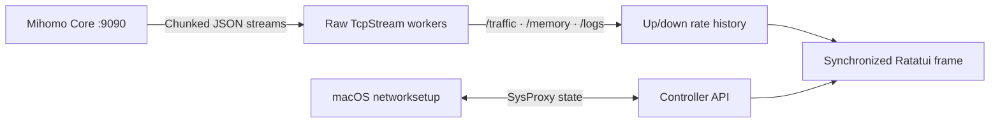

<h1 align="center">terc</h1>

<p align="center">
  <a href="README.md">简体中文</a> · <strong>English</strong>
</p>

<p align="center">
  <strong>Mihomo, on the keys.</strong><br>
  Shorter daily switches, denser state, and a terminal that leaves almost nothing behind.
</p>

<p align="center">
  
  
  
  
</p>

<p align="center">
  <a href="#quick-start"><strong>Get started</strong></a> ·
  <a href="#what-it-shows">Features</a> ·
  <a href="#controls">Controls</a> ·
  <a href="#configuration">Config</a> ·
  <a href="#how-it-works">How it works</a> ·
  <a href="#development">Development</a>
</p>

<p align="center">
  
</p>

## The switches you actually use

Surge keeps TUN, sniffing, routing, and DNS inside menus. `terc` leaves them on one key rail: the press takes effect, and the same screen already shows rate, process, rule chain, and DNS.

| | |
| --- | --- |
| **A shorter daily path** | One key each for TUN, sniff, IPv6, DNS, and routing mode. System proxy changes only when you press Space, and never on its own. |
| **More on one screen** | Braille rate graph, hit counts, inbound, sniffed host, and DNS status stay in view together. |
| **Almost no extra footprint** | Local control is `TcpStream` to `127.0.0.1:9090`. Remote YAML uses the system `curl`. No tokio, reqwest, or openssl. |
| **An open core** | The config stays Mihomo YAML. Quitting closes the UI and leaves the core running. |

`terc` is the companion to [`terb`](https://github.com/pentaoa/terb): the same transparent canvas, rounded title-cutout frames (`╭─┐ Title ┌───╮`), and the Spring, Vintage, and Mono palettes.

## Quick Start

**Requires:** macOS 14+, Rust stable, and a `mihomo` binary (either via `brew install mihomo` or downloaded directly inside `terc`).

```bash
git clone https://github.com/pentaoa/terc.git
cd terc
cargo run --release --locked
```

Press **Space** to toggle the macOS system proxy, or press **K** to start/stop the background `mihomo` daemon. Run `terc --version` to verify the installed version.

On first run `terc` opens a setup window that walks through three steps: paste a subscription URL, locate the `mihomo` binary (<kbd>Ctrl+D</kbd> downloads a managed core) and start the core. <kbd>Esc</kbd> dismisses it and <kbd>u</kbd> brings it back while no subscription is configured — the macOS system proxy is never switched on for you.

> [!NOTE]
> `terc` decouples the UI lifecycle from the proxy core. Closing `terc` with <kbd>q</kbd> immediately frees all terminal UI resources while your background `mihomo` tunnel continues running uninterrupted.

Transparency follows your terminal profile. `terc` leaves the background at its terminal default (`Color::Reset`); configure opacity or blur in your terminal emulator.

## What It Shows

| View | What you get |
| --- | --- |
| **Controls** | One rail for TUN, sniffer, system proxy, routing mode, DNS, IPv6, and WireGuard count |
| **Traffic graph** | btop-style dual up/down rate history on an auto-scaled, labeled axis (`max …/s`), drawn as Braille or Blocks |
| **Overview** | Core pulse, ports, TUN stack, process lookup, memory, connection count, and subscription quota |
| **Groups & Nodes** | Dual-pane selector with protocol tags (`AnyTLS`, `SS`, etc.) and color-graded latency (`ms`) |
| **Connections** | Process, inbound, sniff host, rule payload, chain, and geo/ASN, with one-key close |
| **DNS** | Resolver status from the config, live lookup, and DNS / Fake-IP flush |
| **Rules** | Ordered list with live hit counts, local explain, and runtime disable |
| **Providers** | Proxy and rule providers, refresh one or all, latency health check |
| **Snippets** | YAML overlays for TUN, sniffer, Fake-IP, process lookup, TCP racing, and IPv6 |
| **Profiles** | Switch another YAML onto the running config and hot-reload |
| **Probe** | DNS answers plus a delay test of the selected node |
| **Runtime** | TUN device and any WireGuard or Tailscale outbound the core already exposes |
| **Logs** | Live streaming core logs with severity highlighting |
| **Themes** | Spring, Vintage, and Mono; all preserve the terminal background |

The toolbar stays one row. Narrow terminals keep the key letters and drop the labels.

## Controls

| Where | Key | Action |
| --- | --- | --- |
| Dashboard / Settings | <kbd>Space</kbd> | Toggle macOS system proxy (`networksetup` HTTP / HTTPS / SOCKS5). Never toggled for you |
| Dashboard | <kbd>T</kbd> / <kbd>n</kbd> / <kbd>i</kbd> | Toggle TUN, sniffer, or IPv6. Runtime `PATCH`, then the same value is written back |
| Dashboard | <kbd>D</kbd> | Toggle `dns.enable` in the config and hot-reload |
| Dashboard | <kbd>d</kbd> / <kbd>g</kbd> / <kbd>v</kbd> | DNS, rules, providers |
| Dashboard | <kbd>o</kbd> / <kbd>f</kbd> / <kbd>b</kbd> / <kbd>w</kbd> | Snippet gallery, profiles, probe, WireGuard / runtime |
| Rules | <kbd>/</kbd> or <kbd>e</kbd> | Filter the list and explain a host, IP, or `process:name` |
| Rules | <kbd>x</kbd> | Disable or restore the selected rule (`PATCH /rules/disable`) |
| DNS | <kbd>Enter</kbd> / <kbd>F</kbd> / <kbd>[</kbd> <kbd>]</kbd> | Look up, flush DNS and Fake-IP, cycle record type |
| Providers | <kbd>Enter</kbd> / <kbd>F</kbd> / <kbd>H</kbd> | Refresh the selected provider, refresh all, or health-check a proxy provider |
| Dashboard | <kbd>K</kbd> | Start or stop the background `mihomo` daemon |
| Proxies | <kbd>←</kbd> <kbd>→</kbd>, <kbd>h</kbd> <kbd>l</kbd>, or <kbd>Tab</kbd> | Switch focus between **Groups `[1]`** and **Nodes `[2]`** |
| Any list | <kbd>↑</kbd> <kbd>↓</kbd> or <kbd>j</kbd> <kbd>k</kbd> | Move the selection |
| Nodes | <kbd>Enter</kbd> | Activate the highlighted node in the current group |
| Proxies | <kbd>r</kbd> | Run concurrent URL latency tests for the current group |
| Proxies | <kbd>a</kbd> | Auto-select the lowest-latency node in the current group |
| Dashboard | <kbd>m</kbd> | Cycle routing mode (`Rule` → `Global` → `Direct`) |
| Dashboard | <kbd>u</kbd> | Fetch latest subscription YAML and hot-reload core (`PUT /configs?force=true`); opens the setup window when no URL is saved |
| Setup window | <kbd>Enter</kbd> | Save the subscription URL, write the config and start the core |
| Setup window | <kbd>Ctrl+U</kbd> / <kbd>Ctrl+D</kbd> | Clear the input line / download a managed `mihomo` core |
| Setup window | <kbd>Esc</kbd> | Dismiss for now — <kbd>u</kbd> reopens it while nothing is configured |
| Dashboard | <kbd>p</kbd> / <kbd>c</kbd> / <kbd>L</kbd> | Switch main pane: **Proxies** / **Connections** / **Logs** |
| Connections | <kbd>x</kbd> / <kbd>X</kbd> | Close selected connection / close all active connections |
| Dashboard | <kbd>t</kbd> | Show or hide the top Traffic & Overview panels |
| Menu / Dashboard | <kbd>s</kbd> | Open the dual-pane Settings board |
| Settings | <kbd>←</kbd> <kbd>→</kbd>, <kbd>h</kbd> <kbd>l</kbd>, or <kbd>Enter</kbd> | Adjust setting or trigger action |
| Settings | <kbd>Tab</kbd> | Cycle setting categories (`Core & Proxy` · `Appearance` · `Subscription`) |
| Any view | <kbd>?</kbd> | Open keyboard shortcut help |
| Dashboard / Menu | <kbd>q</kbd> or <kbd>Esc</kbd> | Return or quit (`mihomo` stays running in background) |

## Configuration

Open **Settings** with <kbd>s</kbd>. Changes save immediately to `~/.config/terc/config.json`. The interface supports **中文 · English · 日本語**.

| Category | Options |
| --- | --- |
| **Core & Proxy** | Start/stop `mihomo`, toggle the macOS system proxy, switch routing mode, download `mihomo-darwin-arm64` into `~/.config/terc/core/mihomo` |
| **Snippets** | Built-in YAML overlays, plus any file in `~/.config/terc/modules`. Enabling appends a marked block; disabling removes only that block |
| **Profiles** | YAML files in the config directory and `~/.config/terc/profiles`. Enter copies one onto `config.yaml` and reloads |
| **Appearance** | Palette theme (`Spring` / `Vintage` / `Mono`), rate graph style (`Braille` / `Blocks`), refresh rate (`15` / `30` / `60` / `120 Hz`), UI language |
| **Subscription** | Hot-fetch remote AnyTLS / Clash.Meta YAML subscription and reload without dropping active tunnels |

## How It Works

Instead of pulling in a heavy async HTTP stack, `terc` speaks raw HTTP/1.1 over `std::net::TcpStream` to the local controller (`127.0.0.1:9090`). Background threads read `/traffic`, `/memory`, and `/logs`. Toggles use `PATCH /configs` (`tun.enable`, `sniffing`, `ipv6`). DNS lookup is `GET /dns/query`, flush is `POST /cache/dns/flush` and `POST /cache/fakeip/flush`, and provider refresh is `PUT /providers/...`. Remote subscription downloads still go through `/usr/bin/curl`.



<details>
<summary>Project layout</summary>

```text
assets/terc-hero.svg           Retro terminal: rounded panels, title cutouts, braille graph
src/main.rs                    Event loop, screens, i18n
src/ui.rs                      Rounded cutout Panel, palettes, Braille/Blocks graph
src/panels.rs                  Controls, DNS, rules, providers, overlays
src/control.rs                 Toggle, reload, profile, and probe actions
src/ops.rs                     YAML overlays, rule explain, DNS/rule parsers
src/mihomo.rs                  HTTP/1.1 over TcpStream, streams, networksetup
```

</details>

## Development

```bash
cargo test --all-targets --locked
cargo build --release --locked
```
