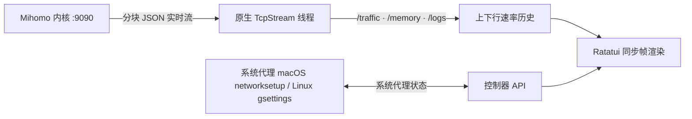

<h1 align="center">terc</h1>

<p align="center">
  <strong>简体中文</strong> · <a href="README.en.md">English</a>
</p>

<p align="center">
  <strong>键盘上的 Mihomo。</strong><br>
  日常开关比菜单短，状态比面板密，足迹只剩一个终端。
</p>

<p align="center">
  
  
  
  
  
</p>

<p align="center">
  <a href="#快速开始"><strong>开始使用</strong></a> ·
  <a href="docs/使用说明.md"><strong>使用说明</strong></a> ·
  <a href="#显示内容">功能</a> ·
  <a href="#快捷键">快捷键</a> ·
  <a href="#配置">配置</a> ·
  <a href="#工作原理">工作原理</a> ·
  <a href="#开发">开发</a>
</p>

<p align="center">
  
</p>

## 每天用的那些开关

Surge 把 TUN、嗅探、分流和 DNS 放进菜单。`terc` 把它们留在同一排键上：按下去就生效，屏上同时看见速率、进程、规则链和解析结果。

| | |
| --- | --- |
| **日常路径更短** | TUN、嗅探、IPv6、DNS、分流模式各一个键。系统代理只在按下空格时改变，从不会自己打开。 |
| **一屏看得更全** | 盲文速率图、命中次数、入站、嗅探域名和 DNS 状态留在同一块屏幕上。 |
| **几乎零足迹** | 本机 `127.0.0.1:9090` 用标准库 `TcpStream`。远端订阅走系统 `curl`。没有 tokio、reqwest、openssl。 |
| **内核是敞开的** | 配置仍是 Mihomo 的 YAML。退出只关界面，后台内核继续跑。 |

`terc` 与 [`terb`](https://github.com/pentaoa/terb) 共用透明画布、圆角镂空标题线框（`╭─┐ Title ┌───╮`）和 Spring、Vintage、Mono 三套配色。

## 快速开始

**需要：** macOS 14 或更新版本，或 Linux（x86_64 / arm64）、Rust 稳定版，以及 `mihomo` 内核。macOS 可用 `brew install mihomo`；两边都可以在设置里下载与本机匹配的官方内核。日常用法见 [使用说明](docs/使用说明.md)。

```bash
git clone https://github.com/pentaoa/terc.git
cd terc
cargo run --release --locked
```

启动后直接进入面板。按 **空格 (`Space`)** 开启或关闭系统代理（macOS 用 `networksetup`，Linux 在有 GNOME `gsettings` 时用 `org.gnome.system.proxy`，否则不动并提示），按 **`K`** 启动或停止后台 `mihomo`。运行 `terc --version` 可查看已安装版本。

还没有订阅链接、配置文件，且内核也没在跑时，会先弹出初始设置：粘贴机场订阅链接、定位 `mihomo` 二进制（<kbd>Ctrl+D</kbd> 按本机下载 `darwin-arm64`、`darwin-amd64`、`linux-arm64` 或 `linux-amd64`）、启动内核。已有配置则跳过这一步，直接进入面板。按 <kbd>Esc</kbd> 可以先关掉，未配置订阅时按 <kbd>u</kbd> 随时重新打开——系统代理永远不会被自动开启。

> [!NOTE]
> `terc` 将界面与内核生命周期完全解耦。按 <kbd>q</kbd> 退出 `terc` 只会关闭终端界面并释放全部 UI 内存，后台 `mihomo` 代理服务依然稳固运行。

透明度沿用终端配置。`terc` 使用终端默认透明背景（`Color::Reset`）；毛玻璃与背景透明度请在终端应用中设置。

## 显示内容

| 视图 | 内容 |
| --- | --- |
| **开关条** | TUN、嗅探、系统代理、分流模式、DNS、IPv6，以及 WireGuard 出站数量 |
| **实时速率图** | btop 风格的上下行双速率历史图，自适应刻度并标注峰值（`max …/s`），支持 Braille 点阵与方块 |
| **内核概览** | 内核脉冲、端口、TUN 栈、进程查找、内存、连接数与套餐余量 |
| **策略组与节点** | 左右双栏，协议标签（如 `AnyTLS`）与按延迟着色的毫秒数 |
| **活跃连接** | 进程、入站、嗅探域名、规则载荷、链路、Geo/ASN，可单条或全部断开 |
| **DNS** | 从配置读出的解析状态、即时查询，以及 DNS / Fake-IP 缓存清空 |
| **规则** | 顺序列表、实时命中次数、本机解释，以及运行时禁用 |
| **订阅源（v）** | `proxy-providers` 与 `rule-providers`，不是机场订阅链接。可单条或全部刷新，代理源可做健康检查 |
| **片段** | TUN、嗅探、Fake-IP、进程名、TCP 竞速、IPv6 的 YAML 叠加 |
| **配置档案** | 把另一份 YAML 换成当前配置并热重载 |
| **探测** | 对当前节点同时做 DNS 查询和延迟测试 |
| **运行时** | TUN 设备，以及内核里已经存在的 WireGuard / Tailscale 出站 |
| **实时日志** | 按级别着色的内核日志流 |
| **主题** | Spring、Vintage、Mono，均保留终端透明背景 |

底部工具栏只占一行。窗口变窄时只保留按键字母。

## 快捷键

| 页面 | 按键 | 操作 |
| --- | --- | --- |
| 面板 / 设置 | <kbd>Space</kbd> | 开启或关闭系统代理。macOS 用 `networksetup`；Linux 用 GNOME `gsettings`，没有则不改动。不会自动打开 |
| 面板 | <kbd>T</kbd> / <kbd>n</kbd> / <kbd>i</kbd> | 开关 TUN、嗅探或 IPv6。先 `PATCH` 运行时，再写回配置 |
| 面板 | <kbd>D</kbd> | 切换配置里的 `dns.enable` 并热重载 |
| 面板 | <kbd>d</kbd> / <kbd>g</kbd> / <kbd>v</kbd> | DNS、规则、Provider |
| 面板 | <kbd>o</kbd> / <kbd>f</kbd> / <kbd>b</kbd> / <kbd>w</kbd> | 片段库、配置档案、探测、WireGuard / 运行时 |
| 规则 | <kbd>/</kbd> 或 <kbd>e</kbd> | 过滤列表，并解释域名、IP 或 `process:名称` |
| 规则 | <kbd>x</kbd> | 禁用或恢复当前规则（`PATCH /rules/disable`） |
| DNS | <kbd>Enter</kbd> / <kbd>F</kbd> / <kbd>[</kbd> <kbd>]</kbd> | 查询、清空 DNS 与 Fake-IP、切换记录类型 |
| Provider | <kbd>Enter</kbd> / <kbd>F</kbd> / <kbd>H</kbd> | 刷新当前项、刷新全部，或对代理源做健康检查 |
| 面板 | <kbd>K</kbd> | 启动或停止后台 `mihomo` 内核 |
| 策略组 / 节点 | <kbd>←</kbd> <kbd>→</kbd>、<kbd>h</kbd> <kbd>l</kbd> 或 <kbd>Tab</kbd> | 在左侧 **策略组 `[1]`** 与右侧 **节点 `[2]`** 之间切换焦点 |
| 任意列表 | <kbd>↑</kbd> <kbd>↓</kbd> 或 <kbd>j</kbd> <kbd>k</kbd> | 上下移动选择 |
| 节点列表 | <kbd>Enter</kbd> | 切换并激活当前高亮节点 |
| 面板 | <kbd>r</kbd> | 对当前策略组内所有节点发起并发延迟测速 |
| 面板 | <kbd>a</kbd> | 自动选中当前策略组中延迟最低的节点 |
| 面板 | <kbd>m</kbd> | 循环切换分流模式（`Rule` → `Global` → `Direct`） |
| 面板 | <kbd>u</kbd> | 拉取最新机场订阅 YAML 并执行零停机热重载；未保存订阅链接时先打开初始设置窗口 |
| 设置窗口 | <kbd>Enter</kbd> | 保存订阅链接、写入配置并启动内核 |
| 设置窗口 | <kbd>Ctrl+U</kbd> / <kbd>Ctrl+D</kbd> | 清空输入行 / 下载托管 `mihomo` 内核 |
| 设置窗口 | <kbd>Esc</kbd> | 暂时关闭，未配置订阅时按 <kbd>u</kbd> 可重新打开 |
| 面板 | <kbd>p</kbd> / <kbd>c</kbd> / <kbd>L</kbd> | 切换主视图：**节点面板** / **连接监控** / **实时日志** |
| 连接监控 | <kbd>x</kbd> / <kbd>X</kbd> | 断开当前选中连接 / 一键断开全部活跃连接 |
| 面板 | <kbd>t</kbd> | 显示或隐藏顶部「实时速率」与「内核状态」面板 |
| 面板 | <kbd>s</kbd> | 打开双栏设置面板。设置里再按一次回到面板 |
| 设置 | <kbd>←</kbd> <kbd>→</kbd>、<kbd>h</kbd> <kbd>l</kbd> 或 <kbd>Enter</kbd> | 调整并保存当前设置项，或执行动作 |
| 设置 | <kbd>Tab</kbd> | 切换设置分类（`内核与代理` · `视觉与主题` · `订阅管理`） |
| 任意页面 | <kbd>?</kbd> | 打开快捷键帮助，再按一次回到面板 |
| 面板 | <kbd>q</kbd> | 退出 `terc`（后台内核保持运行） |
| 面板 | <kbd>Esc</kbd> | 子页面先回到节点页；已在节点页则退出 |
| 设置 / 帮助 | <kbd>Esc</kbd> | 回到面板 |

## 配置

按 <kbd>s</kbd> 打开**设置**。修改即时保存到 `~/.config/terc/config.json`。界面支持 **中文 · English · 日本語**。

| 分类 | 可调内容 |
| --- | --- |
| **内核与代理** | 启停 `mihomo`、切换系统代理、切换分流模式、按本机下载 `mihomo-darwin-arm64`、`darwin-amd64`、`linux-arm64` 或 `linux-amd64` 到 `~/.config/terc/core/mihomo` |
| **片段** | 内置 YAML 叠加，以及 `~/.config/terc/modules` 里的文件。开启时追加标记块，关闭时只删掉这块 |
| **配置档案** | 配置目录和 `~/.config/terc/profiles` 中的 YAML。Enter 会把它写成 `config.yaml` 并热重载 |
| **视觉与主题** | 色彩主题（`Spring` / `Vintage` / `Mono`）、速率图样式（`Braille` / `Blocks`）、刷新率（`15` / `30` / `60` / `120 Hz`）、界面语言 |
| **订阅管理** | 一键拉取远端 AnyTLS / Clash.Meta 订阅配置并通过 `PUT /configs?force=true` 热重载 |

## 工作原理

`terc` 不用异步 HTTP 运行时，而是用标准库 `std::net::TcpStream` 连接本机 `127.0.0.1:9090`。后台线程读取 `/traffic`、`/memory` 和 `/logs`。开关走 `PATCH /configs`（`tun.enable`、`sniffing`、`ipv6`）。DNS 查询是 `GET /dns/query`，清空是 `POST /cache/dns/flush` 与 `POST /cache/fakeip/flush`，Provider 刷新是 `PUT /providers/...`。远端订阅和内核包通过系统 `curl` 下载。



<details>
<summary>项目结构</summary>

```text
assets/terc-hero.svg           复古终端画面：圆角面板、标题切口与盲文速率图
src/main.rs                    事件循环、界面状态与多语言
src/ui.rs                      圆角镂空 Panel、三套主题、Braille/Blocks 速率图
src/panels.rs                  开关条、DNS、规则、Provider 与浮层
src/control.rs                 开关、热重载、配置切换与探测
src/ops.rs                     YAML 叠加、规则解释、DNS/规则解析
src/mihomo.rs                  TcpStream 上的 HTTP/1.1、流式线程、networksetup 与 gsettings
```

</details>

## 开发

```bash
cargo test --all-targets --locked
cargo build --release --locked
```
