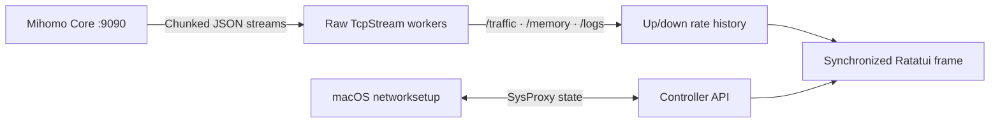

<h1 align="center">terc</h1>

<p align="center">
  <a href="README.zh-CN.md">简体中文</a> · <strong>English</strong>
</p>

<p align="center">
  <strong>Mihomo, in your terminal.</strong><br>
  Live traffic telemetry, proxy orchestration, and system proxy control for macOS.
</p>

<p align="center">
  
  
  
  
</p>

<p align="center">
  <a href="#quick-start"><strong>Get started</strong></a> ·
  <a href="#what-it-shows">Features</a> ·
  <a href="#controls">Controls</a> ·
  <a href="#configuration">Config</a> ·
  <a href="#how-it-works">How it works</a> ·
  <a href="#development">Development</a>
</p>

<p align="center">
  
</p>

`terc` turns your local `mihomo` (Clash.Meta) daemon into a calm, responsive terminal workspace. Built as the companion to [`terb`](https://github.com/pentaoa/terb), it shares the same transparent canvas, rounded title-cutout wireframes (`╭─┐ Title ┌───╮`), and three restrained palettes—while keeping memory footprint near zero and leaving your background proxy untouched when you quit.

## Quick Start

**Requires:** macOS 14+, Rust stable, and a `mihomo` binary (either via `brew install mihomo` or downloaded directly inside `terc`).

```bash
git clone https://github.com/pentaoa/terc.git
cd terc
cargo run --release --locked
```

Press **Space** to toggle the macOS system proxy, or press **K** to start/stop the background `mihomo` daemon. Run `terc --version` to verify the installed version.

On first run `terc` opens a setup window that walks through three steps: paste a subscription URL, locate the `mihomo` binary (<kbd>Ctrl+D</kbd> downloads a managed core) and start the core. <kbd>Esc</kbd> dismisses it and <kbd>u</kbd> brings it back while no subscription is configured — the macOS system proxy is never switched on for you.

> [!NOTE]
> `terc` decouples the UI lifecycle from the proxy core. Closing `terc` with <kbd>q</kbd> immediately frees all terminal UI resources while your background `mihomo` tunnel continues running uninterrupted.

Transparency follows your terminal profile. `terc` leaves the background at its terminal default (`Color::Reset`); configure opacity or blur in your terminal emulator.

## What It Shows

| View | What you get |
| --- | --- |
| **Traffic graph** | btop-style dual up/down rate history on an auto-scaled, labeled axis (`max …/s`), drawn as Braille or Blocks |
| **Overview** | Core pulse indicator, routing mode (`Rule` / `Global` / `Direct`), macOS `SysProxy` badge, memory, and subscription quota |
| **Groups & Nodes** | Dual-pane selector with protocol tags (`AnyTLS`, `SS`, etc.) and color-graded latency (`ms`) |
| **Connections** | Active TCP/UDP flows sorted by bandwidth, matched rules, proxy chains, and one-key termination |
| **Logs** | Live streaming core logs with severity highlighting |
| **Themes** | Spring, Vintage, and Mono; all preserve the terminal background |

The single-row toolbar holds **system proxy toggle · latency test · auto-best · mode · subscription update · views · settings · help**. Smaller terminal windows automatically compact the hints.

## Controls

| Where | Key | Action |
| --- | --- | --- |
| Dashboard / Settings | <kbd>Space</kbd> | Toggle macOS system proxy (`networksetup` HTTP / HTTPS / SOCKS5) |
| Dashboard | <kbd>K</kbd> | Start or stop the background `mihomo` daemon |
| Proxies | <kbd>←</kbd> <kbd>→</kbd>, <kbd>h</kbd> <kbd>l</kbd>, or <kbd>Tab</kbd> | Switch focus between **Groups `[1]`** and **Nodes `[2]`** |
| Any list | <kbd>↑</kbd> <kbd>↓</kbd> or <kbd>j</kbd> <kbd>k</kbd> | Move the selection |
| Nodes | <kbd>Enter</kbd> | Activate the highlighted node in the current group |
| Proxies | <kbd>r</kbd> | Run concurrent URL latency tests for the current group |
| Proxies | <kbd>a</kbd> | Auto-select the lowest-latency node in the current group |
| Dashboard | <kbd>m</kbd> | Cycle routing mode (`Rule` → `Global` → `Direct`) |
| Dashboard | <kbd>u</kbd> | Fetch latest subscription YAML and hot-reload core (`PUT /configs?force=true`); opens the setup window when no URL is saved |
| Setup window | <kbd>Enter</kbd> | Save the subscription URL, write the config and start the core |
| Setup window | <kbd>Ctrl+U</kbd> / <kbd>Ctrl+D</kbd> | Clear the input line / download a managed `mihomo` core |
| Setup window | <kbd>Esc</kbd> | Dismiss for now — <kbd>u</kbd> reopens it while nothing is configured |
| Dashboard | <kbd>p</kbd> / <kbd>c</kbd> / <kbd>L</kbd> | Switch main pane: **Proxies** / **Connections** / **Logs** |
| Connections | <kbd>x</kbd> / <kbd>X</kbd> | Close selected connection / close all active connections |
| Dashboard | <kbd>t</kbd> | Show or hide the top Traffic & Overview panels |
| Menu / Dashboard | <kbd>s</kbd> | Open the dual-pane Settings board |
| Settings | <kbd>←</kbd> <kbd>→</kbd>, <kbd>h</kbd> <kbd>l</kbd>, or <kbd>Enter</kbd> | Adjust setting or trigger action |
| Settings | <kbd>Tab</kbd> | Cycle setting categories (`Core & Proxy` · `Appearance` · `Subscription`) |
| Any view | <kbd>?</kbd> | Open keyboard shortcut help |
| Dashboard / Menu | <kbd>q</kbd> or <kbd>Esc</kbd> | Return or quit (`mihomo` stays running in background) |

## Configuration

Open **Settings** with <kbd>s</kbd>. Changes save immediately to `~/.config/terc/config.json`. The interface supports **中文 · English · 日本語**.

| Category | Options |
| --- | --- |
| **Core & Proxy** | Start/stop `mihomo` daemon, toggle macOS System Proxy, switch routing mode, one-click download latest `mihomo-darwin-arm64` to `~/.config/terc/core/mihomo` |
| **Appearance** | Palette theme (`Spring` / `Vintage` / `Mono`), rate graph style (`Braille` / `Blocks`), refresh rate (`15` / `30` / `60` / `120 Hz`), UI language |
| **Subscription** | Hot-fetch remote AnyTLS / Clash.Meta YAML subscription and reload without dropping active tunnels |

## How It Works

Instead of pulling in a heavy async HTTP/WebSocket stack, `terc` speaks raw HTTP/1.1 over `std::net::TcpStream` directly to `mihomo`'s local controller (`127.0.0.1:9090`). Dedicated background reader threads consume chunked JSON lines from `/traffic`, `/memory`, and `/logs` and push events over a zero-lock `mpsc` channel to the synchronized `ratatui` render loop.



<details>
<summary>Project layout</summary>

```text
assets/terc-hero.svg           Transparent ASCII hero banner (wordmark + node/graph backdrop)
src/main.rs                    Event loop, state machine, traffic history, i18n
src/ui.rs                      Rounded cutout Panel widget, palettes, Braille/Blocks rate graph
src/mihomo.rs                  Zero-dependency HTTP/1.1 client, stream workers, macOS networksetup
```

</details>

## Development

```bash
cargo test --all-targets --locked
cargo build --release --locked
```
