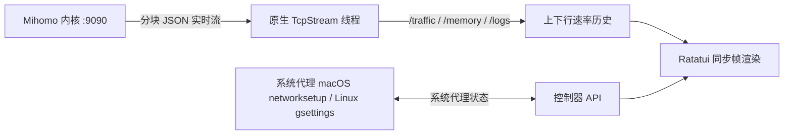

<h1 align="center">terc</h1>

<p align="center">
  <strong>简体中文</strong> &nbsp; / &nbsp; <a href="README.en.md">English</a>
</p>

<p align="center">
  <strong>国内开发者的终极 tui 代理软件</strong>
</p>

<p align="center">
  <code>terc</code> 采纳了现有各个 gui、非 gui 的 Clash 系软件，并对开发者、ai 工具进行了功能增强，致力做到远程友好、内存友好、界面友好、省事。
</p>

<p align="center">
  
  &nbsp;
  
  &nbsp;
  
  &nbsp;
  
  &nbsp;
  
</p>

<p align="center">
  <a href="#快速开始"><strong>开始使用</strong></a> &nbsp; / &nbsp;
  <a href="docs/使用说明.md">使用说明</a> &nbsp; / &nbsp;
  <a href="#显示内容">功能一览</a> &nbsp; / &nbsp;
  <a href="#快捷键">快捷键</a>
</p>

<br>

<p align="center">
  
</p>

<p align="center">
  <a href="https://ghostty.org"></a><br>
  <sub>与 <a href="https://ghostty.org"><strong>Ghostty</strong></a> 搭配体验最佳</sub>
</p>

---

> [!IMPORTANT]
> **使用声明：** 本软件仅供中国大陆以外地区使用，仅用于学习和研究。

## 快速开始

**需要：** macOS 14 或更新版本，或 Linux（x86_64 / arm64）、Rust 稳定版，以及 `mihomo` 内核，建议 v1.19.27 或更新（地区组的 `empty-fallback` 从这一版起生效；更旧的内核 terc 会在启动后提示）。macOS 可用 `brew install mihomo`（已装的用 `brew upgrade mihomo` 更新）；两边都可以在设置里下载与本机匹配的官方内核。日常用法见 [使用说明](docs/使用说明.md)。

```bash
git clone https://github.com/wormforce/terc.git
cd terc
cargo run --release --locked
```

还没有订阅链接、配置文件，且内核也没在跑时，会先弹出初始设置：粘贴机场订阅链接、定位 `mihomo` 二进制（Ctrl+D 按本机下载 `darwin-arm64`、`darwin-amd64-v1`、`linux-arm64` 或 `linux-amd64-v1`）、启动内核。已有配置则跳过这一步，直接进入面板。按 Esc 可以先关掉进入面板，之后在 设置 → 订阅与分流 按 `a` 添加订阅或节点，在 设置 → 排查工具 → 下载 / 更新内核 安装内核。

在面板按 <kbd>Space</kbd> 开启或关闭系统代理（macOS 用 `networksetup`，Linux 在有 GNOME `gsettings` 时用 `org.gnome.system.proxy`，否则不动并提示）。terc 管理的后台 `mihomo` 在 设置 → 内核与代理 → 内核服务 启动或停止；停止内核时只关闭仍指向本机 terc 端口的系统代理，其他代理（例如公司代理）保持不变。

macOS 在 设置 → 内核与代理 → TUN 虚拟网卡 开启 TUN 时，terc 会弹出系统管理员授权窗口，并以管理员权限重启自己管理的 Mihomo；现有连接会短暂中断，界面继续以普通用户运行。取消授权会保留原内核并恢复配置。以后在「内核服务」停止这个内核时也可能需要授权；若配置已开启 TUN，启动内核时会直接请求授权。TUN 启动失败会显示内核错误，不再仅凭 API 返回成功就提示已开启。对于手动启动、使用同一配置目录的本机 Mihomo，terc 会核对控制器端口、程序路径和配置参数，授权后接管并重启。Homebrew/launchd 服务管理的内核，请先在原服务停止，再在「内核服务」由 terc 启动。Linux 请自行通过系统服务或所需网络权限运行 Mihomo。

开启 TUN 前请先断开 Shadowrocket 等其他全流量 VPN，避免双方添加同一组路由而失败。terc 会检测已有虚拟网卡上的冲突路由并提示，不会自动删除其他 VPN 的路由。VPN 接管系统主接口时，系统代理仍按底层活动网卡对应的服务（例如 Wi-Fi）设置。

运行 `terc --version` 可查看已安装版本。

> [!NOTE]  
> `terc` 将界面与内核生命周期完全解耦。按 <kbd>q</kbd> 退出 `terc` 只会关闭终端界面并释放全部 UI 内存，后台 `mihomo` 代理服务依然稳固运行。

## 显示内容

| 视图 | 内容 |
| --- | --- |
| **策略组与节点** | 左右双栏，协议标签（如 `AnyTLS`）与按延迟着色的毫秒数 |
| **开关条** | 系统代理、分流模式与 TUN |
| **实时速率图** | btop 风格的上下行双速率历史图，自适应刻度并标注峰值（`max …/s`），支持 Braille 点阵与方块 |
| **内核概览** | 对齐展示内核运行状态、分流模式、系统代理、TUN、内存与连接数；下方显示端口与套餐余量 |
| **代理订阅** | 统一管理机场、自建和手动节点，在设置窗口内添加、更新和切换；生成配置时补上缺省的 TCP 并发、url-test 容差、Reality 指纹和 Linux TUN GSO，并提示直连境外 DNS 和不支持 UDP 的节点 |
| **分流方案** | 独立选择规则与策略组；每个订阅记住自己的选择，保存的方案可跨订阅复用 |
| **主题** | Spring、Vintage、Mono，均保留终端透明背景 |


按 `s` 打开设置，进入「订阅与分流」直接看到有名称、编号和选中高亮的代理列表；Tab 切换分流列表。按 `a` 打开统一新增表单，选择订阅或代理协议并填写地址、端口、凭据等字段；`e` 编辑选中项。Esc 返回设置。订阅保存节点来源，分流方案保存规则和策略组；切换订阅时恢复它上次选择的分流。可选择跟随订阅、全部代理、各来源缓存的分流，或按 `c` 保存当前分流供多个订阅复用。保存的策略组使用当前订阅的节点，保留组间引用与过滤条件。

<details>
<summary>进阶功能与网络排查</summary>

| 视图 | 内容 |
| --- | --- |
| **活跃连接** | 进程、入站、嗅探域名、规则载荷、链路、Geo/ASN；时长、单连接速率、AI 标记，最近断开的长连接/AI 连接及推断原因；`/` 搜索主机/进程/规则，详情里 `e` 直接解释该目标的规则命中；可单条或全部断开 |
| **DNS** | 从配置读出的解析状态、即时查询（带耗时与查询历史）、查询记录保留最近 32 条，以及 DNS / Fake-IP 缓存清空 |
| **规则** | 顺序列表、实时命中次数、本机解释（目标、命中规则、策略组→节点→延迟、被跳过的前序规则），以及运行时禁用 |
| **流量排行** | 连接页按 `t`：按域名/进程/策略聚合，`g` 切换分组、`o` 切换总量/速率排序 |
| **命令面板** | `:` 或 `Ctrl+P`：搜索并执行切页、系统代理、分流模式、TUN、测速、优选、刷新、退出 |
| **远程资源（设置 → 排查）** | `proxy-providers` 与 `rule-providers`，不是机场订阅链接。可单条或全部刷新，代理源可做健康检查 |
| **片段** | TUN、嗅探、Fake-IP、进程名、TCP 竞速、IPv6 的 YAML 叠加 |
| **探测** | 对当前目标做 DNS 查询，并通过代理测量 TCP / TLS / TTFB / 总耗时；同时测试当前节点延迟 |
| **运行时** | TUN 设备，以及内核里已经存在的 WireGuard / Tailscale 出站 |
| **实时日志** | 按级别着色的内核日志流，支持暂停、搜索和全文阅读 |

</details>

底部只保留一行当前页面的快捷键提示。操作结果以浮动通知显示，普通通知 4 秒、错误通知 8 秒后自动收起；Backspace 可提前收起，按 `!` 仍可查看全文；按 `?` 打开帮助，支持上下键和翻页。连接页按 Enter 可在窄窗口打开完整详情。日志页用 `P` 暂停/继续、`/` 搜索、Enter 阅读全文。

鼠标点击策略组查看节点，点击节点直接切换；滚轮移动所在列表的选择，不会激活节点。当前焦点使用亮色粗边框、▶ 标记与选中行下划线。

## 快捷键

| 页面 | 按键 | 操作 |
| --- | --- | --- |
| 面板 | Space | 开启或关闭系统代理。macOS 用 `networksetup`；Linux 用 GNOME `gsettings`，没有则不改动。不会自动打开；设置 → 内核与代理 → 系统代理 也可用 ← → 或 Enter 切换 |
| 设置 → 内核与代理 | 内核服务 | 启动或停止 terc 管理的后台 `mihomo` 内核 |
| 设置 → 内核与代理 | TUN 虚拟网卡 | 开启或关闭 TUN；macOS 会请求管理员授权 |
| 策略组 / 节点 | ← →、h l 或 Tab | 在左侧 **策略组** `[1]` 与右侧 **节点** `[2]` 之间切换焦点 |
| 任意列表 | ↑ ↓ 或 j k | 上下移动选择 |
| 节点列表 | Enter | 切换并激活当前高亮节点；url-test / fallback 组上为固定（`◆`，失效时自动切换） |
| 面板 | r | 对当前策略组内所有节点发起并发延迟测速 |
| 面板 | a | 弹出优选范围：全球 / 当前连接国家；测速并复测领先节点后按中位数选节点，与最快相差 30 ms / 15% 内保留当前节点 |
| 节点面板 | x | 取消 url-test / fallback 组的固定，恢复自动选择 |
| 面板 | m | 循环切换分流模式（`Rule` → `Global` → `Direct`） |
| 设置 → 订阅与分流 | u | 更新当前订阅的来源缓存并应用它的分流方案 |
| 初始设置 | Enter | 保存订阅链接或节点、写入配置并启动内核 |
| 初始设置 | Ctrl+U / Ctrl+D | 清空输入行 / 下载托管 `mihomo` 内核 |
| 初始设置 | Esc | 关闭并进入面板；之后在 设置 → 订阅与分流 按 `a` 添加来源 |
| 面板 | p / c / L | 切换主视图：**节点面板** / **连接监控** / **实时日志**；DNS、规则、远程资源在 设置 → 排查工具 打开 |
| 设置 → 外观 | 顶部面板 | 显示或隐藏速率与内核状态 |
| 面板 | s | 打开双栏设置面板。设置里再按一次回到面板 |
| 设置 | ← →、h l 或 Enter | 调整并保存当前设置项，或执行动作 |
| 设置 | Tab / Shift+Tab / 1 2 3 4 | 切换设置分类页（`代理` / `外观` / `订阅与分流` / `排查`） |
| 设置 → 外观 | 系统通知 | 开启后内核、TUN、订阅、配置等关键错误会发 macOS / Linux 桌面通知 |
| 面板 | ? | 打开快捷键帮助；帮助里按 ?、Esc 或 q 回到面板 |
| 面板 | q | 退出 `terc`（后台内核保持运行） |
| 面板 | Esc | 子页面回到节点页；退出请按 q |
| 设置 / 帮助 | Esc | 回到面板 |

<details>
<summary>进阶快捷键</summary>

| 页面 | 按键 | 操作 |
| --- | --- | --- |
| 规则 | /、e、Enter | 搜索规则、单独测试目标、查看完整详情 |
| 规则 | x | 禁用或恢复当前规则（`PATCH /rules/disable`） |
| DNS | Enter / F / [ ] | 查询、清空 DNS 与 Fake-IP、切换记录类型 |
| Provider | Enter / F / H | 刷新当前项、刷新全部，或对代理源做健康检查 |
| 连接监控 | x / X | 断开当前选中连接 / 一键断开全部活跃连接 |
| 连接监控 | `/` | 按主机/进程/规则/链路搜索 |
| 连接监控 | t | 流量排行：域名/进程/策略聚合，`g` 分组、`o` 排序 |
| 连接详情 | e | 用当前连接的目标打开规则解释 |
| 面板 | `:` 或 `Ctrl+P` | 打开命令面板，搜索并执行常用动作 |
| 连接监控 | o / f / d | 按流量、时长、速率排序 / 只看长连接和 AI 连接 / 最近断开 |

</details>

首次配置前先安装内核（初始设置里可按 `Ctrl+D` 下载，之后在 设置 → 排查工具 → 下载 / 更新内核）。内核运行时，新配置通过 `PUT /configs?force=true` 交给运行中的内核校验并加载，被拒绝时配置文件保持不变；内核未运行，或配置用到本地缺少的 GeoIP / GeoSite 数据时，先运行 `mihomo -t` 验证再写入。端口、局域网等可热更新的设置走 `PATCH /configs`，不重载；生成结果没有变化时也不重载。更新订阅或切换来源会重新应用已启用片段。设置里的「内核服务」只停止 terc 启动的内核，外部服务请使用对应服务管理器。

优选只比较当前 Selector、url-test 或 fallback 策略组的可选代理节点；url-test / fallback 组按组自己的测速地址和状态码判断，结果以固定生效。当前国家根据已连接节点名称的国旗、国家名称或独立代码识别，不代表出口 IP 定位；识别失败或无可达节点时保持原连接。

## CLI（脚本 / agent）

不带参数运行 `terc` 仍然打开 TUI；带子命令时直接与控制器交互，不依赖正在运行的 TUI。所有命令都支持 `--json`，便于脚本和 agent 消费。

| 命令 | 作用 |
| --- | --- |
| `terc status` | 内核状态、版本、分流模式、端口、系统代理、TUN、连接数、总流量 |
| `terc proxies` | 策略组列表、当前选中节点、固定状态、节点数 |
| `terc conns --limit 20 --grep Safari` | 活跃连接，按总流量排序，可按主机/进程/规则过滤 |
| `terc use <group> <node> [--pin]` | 切换节点；`--pin` 用于 url-test / fallback 固定 |
| `terc mode rule\|global\|direct` | 切换分流模式 |
| `terc test <group>` | 并发测速一个策略组 |
| `terc dns <name> [--type A]` | 通过内核查询 DNS |
| `terc explain <target>` | 规则命中解释：命中规则、被跳过的前序规则 |
| `terc sysproxy on\|off [--yes]` | 开关系统代理；`on` 必须显式 `--yes` |
| `terc notify-test` | 验证桌面通知后端 |

```bash
terc status --json
terc conns --limit 10 --grep Music --json
terc use "Proxies" "🇯🇵 Japan 06"
terc explain example.com
```

只读命令默认安全；`sysproxy on` 会改变整机网络路径，因此必须显式 `--yes`，不会在 agent 会话里自动开启。

## 配置

按 s 打开**设置**。界面偏好保存在 `~/.config/terc/config.json`，代理设置写回内核配置。界面支持 **中文 / English / 日本語**。

| 分类 | 可调内容 |
| --- | --- |
| **内核与代理** | 启停 `mihomo`、切换系统代理、切换分流模式 |
| **排查工具** | 按本机下载 `mihomo-darwin-arm64`、`darwin-amd64-v1`、`linux-arm64` 或 `linux-amd64-v1` 到 `~/.config/terc/core/mihomo`；DNS、规则、远程资源、片段、探测、运行详情、日志、内核日志级别、连接实时推送 |
| **片段** | 内置 YAML 叠加，以及 `~/.config/terc/modules` 里的文件。开启时递归合并映射，关闭时还原原配置；应用前由内核验证 |
| **视觉与主题** | 色彩主题（`Spring` / `Vintage` / `Mono`）、速率图样式（`Braille` / `Blocks`）、界面刷新率（`15` / `30` / `60` / `120 Hz`，重绘上限，画面不变时不重绘）、图表更新间隔（`1000–86400000 ms`，方向键每次调 `100 ms`，Enter 可直接输入；取期间平均速率，改变间隔会清空旧图）、界面语言 |
| **代理订阅与分流方案** | 节点来源与规则策略独立管理，订阅记住分流选择，方案可复用；校验后应用。支持优先匹配的增量手动规则，更新订阅后保留；自有分流与 AI 预设编辑暂缓 |
| **常用代理设置** | 混合 / HTTP / SOCKS 端口、局域网访问、TUN、DNS、IPv6、测速地址和超时；诊断工具集中在设置的排查分类 |

图表间隔按毫秒设置；Mihomo 流量流通常每秒提供一份数据，因此最小间隔为 1000 ms。

## 工作原理

`terc` 不用异步 HTTP 运行时，而是用标准库 `std::net::TcpStream` 连接本机 `127.0.0.1:9090`。后台线程读取 `/traffic`、`/memory` 和 `/logs`；`/connections` 走 WebSocket 推送（`src/ws.rs`，只用标准库），不可用时回退到轮询。开关走 `PATCH /configs`（`tun.enable`、`sniffing`、`ipv6`）。DNS 查询是 `GET /dns/query`，清空是 `POST /cache/dns/flush` 与 `POST /cache/fakeip/flush`，Provider 刷新是 `PUT /providers/...`。远端订阅和内核包通过系统 `curl` 下载。



<details>
<summary>项目结构</summary>

```text
assets/terc-hero.png           terc 界面截图：实时速率、代理控制、策略组和节点列表
src/main.rs                    事件循环、界面状态与多语言
src/ui.rs                      圆角镂空 Panel、三套主题、Braille/Blocks 速率图
src/panels.rs                  开关条、DNS、规则、Provider 与浮层
src/control.rs                 开关、热重载、配置切换与探测
src/ops.rs                     YAML 叠加、规则解释、DNS/规则解析
src/mihomo.rs                  TcpStream 上的 HTTP/1.1、流式线程、networksetup 与 gsettings
```

</details>

## 开发

```bash
cargo test --all-targets --locked
cargo build --release --locked
```
