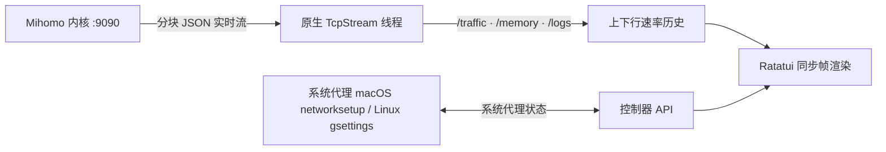

<h1 align="center">terc</h1>

<p align="center">
  <strong>简体中文</strong> &nbsp; / &nbsp; <a href="README.en.md">English</a>
</p>

<p align="center">
  <strong>把代理控制台，搬进终端。</strong>
</p>

<p align="center">
  为开发者与 AI 工作流打造的 Mihomo 终端代理工具。<br>
  <sub>键盘直达 &nbsp; · &nbsp; 实时流量 &nbsp; · &nbsp; SSH 友好</sub>
</p>

<p align="center">
  
  &nbsp;
  
  &nbsp;
  
  &nbsp;
  
  &nbsp;
  
</p>

<p align="center">
  <a href="#快速开始"><strong>开始使用</strong></a> &nbsp; · &nbsp;
  <a href="docs/使用说明.md">使用说明</a> &nbsp; · &nbsp;
  <a href="#显示内容">功能一览</a> &nbsp; · &nbsp;
  <a href="#快捷键">快捷键</a>
</p>

<br>

<p align="center">
  
</p>

<p align="center">
  <a href="https://ghostty.org"></a><br>
  <sub>推荐搭配 <a href="https://ghostty.org"><strong>Ghostty</strong></a> 使用</sub>
</p>

---

## 快速开始

**需要：** macOS 14 或更新版本，或 Linux（x86_64 / arm64）、Rust 稳定版，以及 `mihomo` 内核。macOS 可用 `brew install mihomo`；两边都可以在设置里下载与本机匹配的官方内核。日常用法见 [使用说明](docs/使用说明.md)。

```bash
git clone https://github.com/wormforce/terc.git
cd terc
cargo run --release --locked
```

还没有订阅链接、配置文件，且内核也没在跑时，会先弹出初始设置：粘贴机场订阅链接、定位 `mihomo` 二进制（Ctrl+D 按本机下载 `darwin-arm64`、`darwin-amd64`、`linux-arm64` 或 `linux-amd64`）、启动内核。已有配置则跳过这一步，直接进入面板。按 Esc 可以先关掉，未配置订阅时按 u 随时重新打开。

按 <kbd>Space</kbd> 开启或关闭系统代理（macOS 用 `networksetup`，Linux 在有 GNOME `gsettings` 时用 `org.gnome.system.proxy`，否则不动并提示），按 <kbd>K</kbd> 启动或停止 terc 管理的后台 `mihomo`。

运行 `terc --version` 可查看已安装版本。

> [!NOTE]  
> `terc` 将界面与内核生命周期完全解耦。按 <kbd>q</kbd> 退出 `terc` 只会关闭终端界面并释放全部 UI 内存，后台 `mihomo` 代理服务依然稳固运行。

## 显示内容

| 视图 | 内容 |
| --- | --- |
| **开关条** | TUN、嗅探、系统代理、分流模式、DNS、IPv6，以及 WireGuard 出站数量 |
| **实时速率图** | btop 风格的上下行双速率历史图，自适应刻度并标注峰值（`max …/s`），支持 Braille 点阵与方块 |
| **内核概览** | 内核脉冲、端口、TUN 栈、进程查找、内存、连接数与套餐余量 |
| **策略组与节点** | 左右双栏，协议标签（如 `AnyTLS`）与按延迟着色的毫秒数 |
| **活跃连接** | 进程、入站、嗅探域名、规则载荷、链路、Geo/ASN，可单条或全部断开 |
| **DNS** | 从配置读出的解析状态、即时查询，以及 DNS / Fake-IP 缓存清空 |
| **规则** | 顺序列表、实时命中次数、本机解释，以及运行时禁用 |
| **订阅源（v）** | `proxy-providers` 与 `rule-providers`，不是机场订阅链接。可单条或全部刷新，代理源可做健康检查 |
| **片段** | TUN、嗅探、Fake-IP、进程名、TCP 竞速、IPv6 的 YAML 叠加 |
| **配置档案** | 把另一份 YAML 换成当前配置并热重载 |
| **探测** | 对当前节点同时做 DNS 查询和延迟测试 |
| **运行时** | TUN 设备，以及内核里已经存在的 WireGuard / Tailscale 出站 |
| **实时日志** | 按级别着色的内核日志流，支持暂停、搜索和全文阅读 |
| **主题** | Spring、Vintage、Mono，均保留终端透明背景 |

底部提供当前页面的操作提示，独立状态栏保留操作结果。按 `!` 查看完整结果；按 `?` 打开帮助，支持上下键和翻页。连接页按 Enter 可在窄窗口打开完整详情。日志页用 `P` 暂停/继续、`/` 搜索、Enter 阅读全文。

## 快捷键

| 页面 | 按键 | 操作 |
| --- | --- | --- |
| 面板 / 设置 | Space | 开启或关闭系统代理。macOS 用 `networksetup`；Linux 用 GNOME `gsettings`，没有则不改动。不会自动打开 |
| 面板 | T / n / i | 开关 TUN、嗅探或 IPv6。先 `PATCH` 运行时，再写回配置 |
| 面板 | D | 切换配置里的 `dns.enable` 并热重载 |
| 面板 | d / g / v | DNS、规则、Provider |
| 面板 | o / f / b / w | 片段库、配置档案、探测、WireGuard / 运行时 |
| 规则 | / 或 e | 过滤列表，并解释域名、IP 或 `process:名称` |
| 规则 | x | 禁用或恢复当前规则（`PATCH /rules/disable`） |
| DNS | Enter / F / [ ] | 查询、清空 DNS 与 Fake-IP、切换记录类型 |
| Provider | Enter / F / H | 刷新当前项、刷新全部，或对代理源做健康检查 |
| 面板 | K | 启动或停止 terc 管理的后台 `mihomo` 内核 |
| 策略组 / 节点 | ← →、h l 或 Tab | 在左侧 **策略组** `[1]` 与右侧 **节点** `[2]` 之间切换焦点 |
| 任意列表 | ↑ ↓ 或 j k | 上下移动选择 |
| 节点列表 | Enter | 切换并激活当前高亮节点 |
| 面板 | r | 对当前策略组内所有节点发起并发延迟测速 |
| 面板 | a | 自动选中当前策略组中延迟最低的节点 |
| 面板 | m | 循环切换分流模式（`Rule` → `Global` → `Direct`） |
| 面板 | u | 拉取最新机场订阅 YAML 并执行零停机热重载；未保存订阅链接时先打开初始设置窗口 |
| 设置窗口 | Enter | 保存订阅链接、写入配置并启动内核 |
| 设置窗口 | Ctrl+U / Ctrl+D | 清空输入行 / 下载托管 `mihomo` 内核 |
| 设置窗口 | Esc | 暂时关闭，未配置订阅时按 u 可重新打开 |
| 面板 | p / c / L | 切换主视图：**节点面板** / **连接监控** / **实时日志** |
| 连接监控 | x / X | 断开当前选中连接 / 一键断开全部活跃连接 |
| 面板 | t | 显示或隐藏顶部「实时速率」与「内核状态」面板 |
| 面板 | s | 打开双栏设置面板。设置里再按一次回到面板 |
| 设置 | ← →、h l 或 Enter | 调整并保存当前设置项，或执行动作 |
| 设置 | Tab | 切换设置分类（`内核与代理` · `视觉与主题` · `订阅管理`） |
| 任意页面 | ? | 打开快捷键帮助，再按一次回到面板 |
| 面板 | q | 退出 `terc`（后台内核保持运行） |
| 面板 | Esc | 子页面回到节点页；退出请按 q |
| 设置 / 帮助 | Esc | 回到面板 |

首次配置前先安装内核（设置窗口内可按 `Ctrl+D` 下载）。订阅、片段和档案会先运行 `mihomo -t` 验证，再替换配置；热重载被拒绝时恢复旧文件。更新订阅或切换档案会重新应用已启用片段。`K` 只停止 terc 启动的内核，外部服务请使用对应服务管理器。

## 配置

按 s 打开**设置**。修改即时保存到 `~/.config/terc/config.json`。界面支持 **中文 · English · 日本語**。

| 分类 | 可调内容 |
| --- | --- |
| **内核与代理** | 启停 `mihomo`、切换系统代理、切换分流模式、按本机下载 `mihomo-darwin-arm64`、`darwin-amd64`、`linux-arm64` 或 `linux-amd64` 到 `~/.config/terc/core/mihomo` |
| **片段** | 内置 YAML 叠加，以及 `~/.config/terc/modules` 里的文件。开启时递归合并映射，关闭时还原原配置；应用前由内核验证 |
| **配置档案** | 配置目录和 `~/.config/terc/profiles` 中的 YAML。Enter 会把它写成 `config.yaml` 并热重载 |
| **视觉与主题** | 色彩主题（`Spring` / `Vintage` / `Mono`）、速率图样式（`Braille` / `Blocks`）、刷新率（`15` / `30` / `60` / `120 Hz`）、界面语言 |
| **订阅管理** | 一键拉取远端 AnyTLS / Clash.Meta 订阅配置并通过 `PUT /configs?force=true` 热重载 |

## 工作原理

`terc` 不用异步 HTTP 运行时，而是用标准库 `std::net::TcpStream` 连接本机 `127.0.0.1:9090`。后台线程读取 `/traffic`、`/memory` 和 `/logs`。开关走 `PATCH /configs`（`tun.enable`、`sniffing`、`ipv6`）。DNS 查询是 `GET /dns/query`，清空是 `POST /cache/dns/flush` 与 `POST /cache/fakeip/flush`，Provider 刷新是 `PUT /providers/...`。远端订阅和内核包通过系统 `curl` 下载。



<details>
<summary>项目结构</summary>

```text
assets/terc-hero.svg           复古终端画面：圆角面板、标题切口与盲文速率图
src/main.rs                    事件循环、界面状态与多语言
src/ui.rs                      圆角镂空 Panel、三套主题、Braille/Blocks 速率图
src/panels.rs                  开关条、DNS、规则、Provider 与浮层
src/control.rs                 开关、热重载、配置切换与探测
src/ops.rs                     YAML 叠加、规则解释、DNS/规则解析
src/mihomo.rs                  TcpStream 上的 HTTP/1.1、流式线程、networksetup 与 gsettings
```

</details>

## 开发

```bash
cargo test --all-targets --locked
cargo build --release --locked
```
