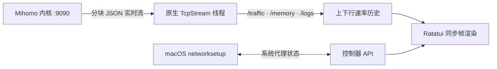

<h1 align="center">terc</h1>

<p align="center">
  <strong>简体中文</strong> · <a href="README.md">English</a>
</p>

<p align="center">
  <strong>在终端里，从容掌控 Mihomo。</strong><br>
  面向 macOS 的实时速率图表、策略组编排与系统代理终端控制器。
</p>

<p align="center">
  
  
  
  
</p>

<p align="center">
  <a href="#快速开始"><strong>开始使用</strong></a> ·
  <a href="#显示内容">功能</a> ·
  <a href="#快捷键">快捷键</a> ·
  <a href="#配置">配置</a> ·
  <a href="#工作原理">工作原理</a> ·
  <a href="#开发">开发</a>
</p>

<p align="center">
  
</p>

`terc` 是与 [`terb`](https://github.com/pentaoa/terb) 一脉相承的 Mihomo (Clash.Meta) 终端管理界面。它沿用了 `terb` 标志性的透明画布、圆角镂空标题线框（`╭─┐ Title ┌───╮`）和三套克制的低饱和配色，让你在 1.4 MB 的纯原生二进制中完成节点测速、系统代理切换、订阅热重载与连接监控——用完即关，UI 内存占用归零。

## 快速开始

**需要：** macOS 14 或更新版本、Rust 稳定版，以及 `mihomo` 内核（可通过 `brew install mihomo` 安装，或在 `terc` 设置页内一键下载托管内核）。

```bash
git clone https://github.com/pentaoa/terc.git
cd terc
cargo run --release --locked
```

按 **空格 (`Space`)** 一键开启或关闭 macOS 系统代理，按 **`K`** 启动或停止后台 `mihomo` 服务。运行 `terc --version` 可查看已安装版本。

> [!NOTE]
> `terc` 将界面与内核生命周期完全解耦。按 <kbd>q</kbd> 退出 `terc` 只会关闭终端界面并释放全部 UI 内存，后台 `mihomo` 代理服务依然稳固运行。

透明度沿用终端配置。`terc` 使用终端默认透明背景（`Color::Reset`）；毛玻璃与背景透明度请在终端应用中设置。

## 显示内容

| 视图 | 内容 |
| --- | --- |
| **实时速率图** | btop 风格的上下行双速率历史图，自适应刻度并在图上标注峰值（`max …/s`），支持 Braille 点阵与方块两种样式 |
| **内核概览** | 内核呼吸脉冲指示灯、分流模式（`Rule` / `Global` / `Direct`）、系统代理状态、内存占用与套餐到期/余量提取 |
| **策略组与节点** | 左右双栏联动，展示节点协议标签（如 `AnyTLS`）与分级着色的实时延迟（`ms`） |
| **活跃连接** | 按流量排序的实时 TCP/UDP 会话、命中规则与代理链路，支持单条或全部一键断开 |
| **实时日志** | 按级别着色的内核实时流式日志 |
| **主题** | Spring、Vintage、Mono，均保留终端透明背景 |

底部工具栏只占一行：**系统代理开关 · 测速 · 优选 · 模式 · 更新订阅 · 视图切换 · 设置 · 帮助**。小窗口会自动折叠长标签。

## 快捷键

| 页面 | 按键 | 操作 |
| --- | --- | --- |
| 面板 / 设置 | <kbd>Space</kbd> | 一键开启或关闭 macOS 系统代理（自动调用 `networksetup`） |
| 面板 | <kbd>K</kbd> | 一键启动或停止后台 `mihomo` 内核进程 |
| 策略组 / 节点 | <kbd>←</kbd> <kbd>→</kbd>、<kbd>h</kbd> <kbd>l</kbd> 或 <kbd>Tab</kbd> | 在左侧 **策略组 `[1]`** 与右侧 **节点 `[2]`** 之间切换焦点 |
| 任意列表 | <kbd>↑</kbd> <kbd>↓</kbd> 或 <kbd>j</kbd> <kbd>k</kbd> | 上下移动选择 |
| 节点列表 | <kbd>Enter</kbd> | 切换并激活当前高亮节点 |
| 面板 | <kbd>r</kbd> | 对当前策略组内所有节点发起并发延迟测速 |
| 面板 | <kbd>a</kbd> | 自动选中当前策略组中延迟最低的节点 |
| 面板 | <kbd>m</kbd> | 循环切换分流模式（`Rule` → `Global` → `Direct`） |
| 面板 | <kbd>u</kbd> | 拉取最新机场订阅 YAML 并执行零停机热重载 |
| 面板 | <kbd>p</kbd> / <kbd>c</kbd> / <kbd>L</kbd> | 切换主视图：**节点面板** / **连接监控** / **实时日志** |
| 连接监控 | <kbd>x</kbd> / <kbd>X</kbd> | 断开当前选中连接 / 一键断开全部活跃连接 |
| 面板 | <kbd>t</kbd> | 显示或隐藏顶部「实时速率」与「内核状态」面板 |
| 菜单 / 面板 | <kbd>s</kbd> | 打开双栏设置面板 |
| 设置 | <kbd>←</kbd> <kbd>→</kbd>、<kbd>h</kbd> <kbd>l</kbd> 或 <kbd>Enter</kbd> | 调整并保存当前设置项，或执行动作 |
| 设置 | <kbd>Tab</kbd> | 切换设置分类（`内核与代理` · `视觉与主题` · `订阅管理`） |
| 任意页面 | <kbd>?</kbd> | 打开快捷键帮助，再按一次返回 |
| 面板 / 菜单 | <kbd>q</kbd> 或 <kbd>Esc</kbd> | 返回上级或退出 `terc`（后台内核保持运行） |

## 配置

按 <kbd>s</kbd> 打开**设置**。修改即时保存到 `~/.config/terc/config.json`。界面支持 **中文 · English · 日本語**。

| 分类 | 可调内容 |
| --- | --- |
| **内核与代理** | 启停 `mihomo` 后台进程、切换 macOS 系统代理、切换分流模式、一键下载官方 `mihomo-darwin-arm64` 至 `~/.config/terc/core/mihomo` |
| **视觉与主题** | 色彩主题（`Spring` / `Vintage` / `Mono`）、速率图样式（`Braille` / `Blocks`）、刷新率（`15` / `30` / `60` / `120 Hz`）、界面语言 |
| **订阅管理** | 一键拉取远端 AnyTLS / Clash.Meta 订阅配置并通过 `PUT /configs?force=true` 热重载 |

## 工作原理

为了保持微秒级启动与极小体积，`terc` 不依赖庞大的异步网络运行时，而是通过标准库 `std::net::TcpStream` 直接与本机 `127.0.0.1:9090` 通信。独立后台线程持续读取 `/traffic`、`/memory` 与 `/logs` 的 HTTP 分块 JSON 流，经由无锁通道送入 `ratatui` 同步渲染循环。



<details>
<summary>项目结构</summary>

```text
assets/terc-hero.svg           透明背景 SVG 顶部视觉插画
src/main.rs                    主事件循环、状态机、流量历史与多语言词典
src/ui.rs                      圆角镂空 Panel 组件、三套主题、Braille/Blocks 速率图渲染
src/mihomo.rs                  零依赖 HTTP/1.1 客户端、流式监控线程与 macOS networksetup 控制
```

</details>

## 开发

```bash
cargo test --all-targets --locked
cargo build --release --locked
```
